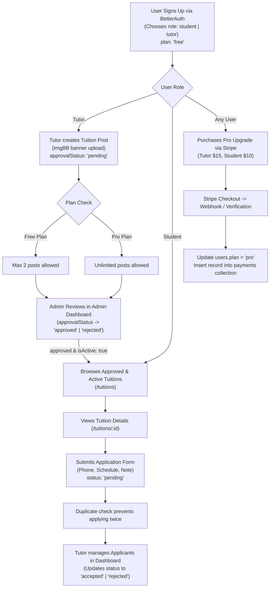

<!-- BEGIN:nextjs-agent-rules -->

# This is NOT the Next.js you know

This version has breaking changes — APIs, conventions, and file structure may all differ from your training data. Read the relevant guide in `node_modules/next/dist/docs/` (resolved from this file's directory; in monorepos the `next` package may not be visible from the repo root) before writing any code. Heed deprecation notices.

This block is written and re-added by `next dev` — verify at `node_modules/next/dist/server/lib/generate-agent-files.js`. Removing it from a diff only re-creates the uncommitted change; committing it with your work keeps the tree clean.

<!-- END:nextjs-agent-rules -->

# 📚 MentorLagbe — Project Knowledge Base & AI Developer Specification

> **Project Name:** MentorLagbe (Smart Tuition & Mentorship Platform)  
> **Assignment:** Category 001 | Assignment 9  
> **Reference Video:** `b-14-a-9-cat-001.mp4` *(Always prioritize this specification document over video discrepancies)*  
> **Theme:** EdTech / Online & Home Tuition Finder and Booking Platform  
> **Last Updated:** November 2026

---

## 🎯 Project Overview & Vision

**MentorLagbe** is a full-stack, role-based tuition management and mentorship platform designed to connect qualified tutors offering subject-wise tuition batches or 1-on-1 mentorship with students seeking personalized academic guidance. It includes an administrative governance layer for moderating listings, managing user roles, and monitoring revenue generated through Stripe subscriptions.

### Target Problem & Solution
- **Problem:** Students and parents worldwide (especially in Bangladesh) struggle to find verified, subject-specific tutors with transparent class levels, modes (Online/Offline), and pricing. Skilled tutors also lack a streamlined portal to advertise their batches and manage student applications.
- **Solution:** A unified ecosystem with role-specific dashboards, secure authentication, admin moderation, direct application pipelines, and tiered Pro subscriptions.

---

## 👥 Stakeholders & Role Matrix

| Stakeholder | Role Key | Primary Capabilities |
| :--- | :--- | :--- |
| **Student** | `'student'` | Search & filter tuitions, view details, apply for sessions, track application statuses, bookmark tuitions, submit ratings/reviews, upgrade to Pro. |
| **Tutor** | `'tutor'` | Create tuition listings (with ImgBB image upload), manage active/closed status, edit/delete tuitions, review incoming student applications (accept/reject), upgrade to Pro. |
| **Admin** | `'admin'` | Moderate tuition listings (approve/reject), manage all users and roles, inspect Stripe revenue transactions, view system-wide analytics. |

---

## 🛠️ Technology Stack & Architecture

### Frontend (Client)
- **Framework:** Next.js (App Router, React 19, TypeScript)
- **Styling & UI:** Tailwind CSS v4, Shadcn UI / HeroUI / DaisyUI, Lucide React icons
- **Theming:** `next-themes` (Dark/Light mode support)
- **Notifications:** `sonner` / `react-hot-toast` for rich toast notifications
- **Image Hosting:** Direct multipart image upload to **ImgBB API**
- **Payments UI:** Stripe Checkout client redirect & status callbacks

### Backend (Server)
- **Runtime & Framework:** Node.js, Express.js (TypeScript or JavaScript)
- **Database:** MongoDB (Native Driver / Mongoose)
- **Authentication:** **BetterAuth** with MongoDB Adapter + Client-side JWT integration
- **Authorization:** Custom Express middlewares (`verifyToken`, `verifyStudent`, `verifyTutor`, `verifyAdmin`)
- **Payment Processing:** **Stripe** Checkout Sessions & Stripe Webhooks (raw body signature verification)

---

## 🗄️ Database Architecture (Strictly 4 Collections)

The database schema is strictly structured around **four (4) core collections**:

### 1. `users` Collection
Stores all registered accounts, role configurations, profile details, and subscription tiers.
```typescript
interface User {
  _id: ObjectId | string;
  name: string;
  email: string;
  image?: string;                     // ImgBB uploaded URL or external image URL
  role: 'student' | 'tutor' | 'admin';
  phone?: string;
  bio?: string;
  plan: 'free' | 'pro';               // Default is 'free'
  createdAt: Date | string;
}
```

### 2. `tuitions` Collection
Stores all tuition posts and mentorship offerings created by tutors.
```typescript
interface Tuition {
  _id: ObjectId | string;
  title: string;
  subject: string;
  classLevel: string;                 // e.g., 'Class 9-10', 'HSC', 'O-Levels', 'Undergraduate'
  mode: 'Online' | 'Offline';
  location: string;                   // Physical location or 'Online' / platform link
  monthlyFee: number;
  daysPerWeek: number;
  bannerImage: string;                // Hosted image URL via ImgBB
  description: string;
  tutorName: string;
  tutorEmail: string;
  approvalStatus: 'pending' | 'approved' | 'rejected'; // Default: 'pending'
  isActive: boolean;                  // Default: true (Tutor can toggle Active/Closed)
  createdAt: Date | string;
}
```

### 3. `applications` Collection
Stores student enrollment/booking applications submitted for specific tuitions.
```typescript
interface Application {
  _id: ObjectId | string;
  tuitionId: ObjectId | string;
  tuitionTitle: string;
  subject: string;
  monthlyFee: number;
  tutorEmail: string;
  studentName: string;
  studentEmail: string;
  studentPhone: string;
  preferredSchedule: string;          // Preferred time slots or days
  studentNote: string;
  status: 'pending' | 'accepted' | 'rejected'; // Default: 'pending'
  appliedAt: Date | string;
}
```

### 4. `payments` Collection
Stores transaction records for Pro plan subscription upgrades through Stripe.
```typescript
interface Payment {
  _id: ObjectId | string;
  userEmail: string;
  userName: string;
  userRole: 'student' | 'tutor';
  planName: string;                   // 'Pro Tutor' ($15) or 'Pro Student' ($10)
  amount: number;                     // 15 or 10 (USD)
  currency: string;                   // 'usd'
  transactionId: string;              // Stripe payment_intent or balance_transaction
  stripeSessionId: string;
  paymentStatus: 'paid';
  paidAt: Date | string;
}
```

---

## 🔄 End-to-End Logical Business Workflow



### Step-by-Step Business Logic:
1. **Role Registration:**
   - User signs up on `/sign-up` specifying role (`student` or `tutor`).
   - Saved with initial `plan: 'free'`.
2. **Posting a Tuition:**
   - Tutor creates tuition via `/dashboard/tutor/post-tuition`.
   - **Post Limit Rules:** Free tutors can post at most **2 tuitions**; Pro tutors can post **unlimited**.
   - Created with `approvalStatus: 'pending'` and `isActive: true`.
3. **Admin Moderation:**
   - Admin inspects pending listings at `/dashboard/admin/tuitions`.
   - Admin approves or rejects. Only listings with `approvalStatus === 'approved'` AND `isActive === true` appear on `/tuitions` and `/` featured section.
4. **Student Application:**
   - Student visits `/tuitions/[id]`.
   - Non-students (Tutors/Admins/Unauthenticated) cannot submit (button disabled or hidden with explanatory message).
   - Prevents duplicate applications from the same student for the same tuition ID.
   - Status defaults to `'pending'`.
5. **Tutor Applicant Management:**
   - Tutor accesses `/dashboard/tutor/applicants` to review student submissions and sets status to `'accepted'` or `'rejected'`.
6. **Stripe Subscription Upgrade:**
   - Tutors upgrade to Pro for **$15** (unlimited posts + verified badge).
   - Students upgrade to Pro for **$10** (priority booking).
   - Stripe webhook verifies session, logs transaction into `payments`, and sets user `plan = 'pro'`.

---

## 🗺️ Layout, Pages & Route Architecture

### 1. Navigation & Global Layout
- **Navbar:**
  - Consistent branding and logo: **MentorLagbe**.
  - Public Links: Home (`/`), Browse Tuitions (`/tuitions`), Pricing / Pro Plans (`/pricing`), How It Works / About.
  - **Unauthenticated View:** 'Sign In' and 'Sign Up' action buttons.
  - **Authenticated View:** User Avatar, Full Name, Role Badge (`Student` / `Tutor` / `Admin`), 'Dashboard' link, 'Update Profile' link, 'Sign Out' button.
- **Footer:**
  - MentorLagbe logo, concise tagline, navigation quick-links, contact info (email, phone, address).
  - Copyright notices and social media icons (MUST use the **new 𝕏 logo**, NOT the deprecated Twitter bird).

### 2. Public Pages
- `/` — **Home Page:**
  - Hero Section with headline, CTA leading to `/tuitions`, and modern graphic illustration.
  - Dynamic Featured Tuitions: 6 latest approved & active listings from MongoDB (uniform card height & width).
  - Pricing & Pro Subscription plans teaser.
  - Extra Section 1: Visual 3-4 step workflow (*How MentorLagbe Works*).
  - Extra Section 2: Top Subject Categories (Math, Physics, Programming, IELTS), platform statistics, and testimonials.
- `/tuitions` — **Browse Tuitions Page:**
  - Server-side search (by Title or Subject).
  - Multi-parameter filter dropdowns (by Subject, Class Level, Mode: Online/Offline).
  - Responsive grid of cards with equal dimensions.
- `/tuitions/[id]` — **Tuition Details Page:**
  - Banner image, title, subject, class level, schedule, location/mode, monthly fee, description, tutor profile summary.
  - 'Apply for Tuition' modal/form (Students only; duplicate prevention applied).
- `/pricing` — **Pricing & Pro Plans Page:**
  - Feature comparison matrix between Free vs Pro for Tutors ($15) and Students ($10).
  - Direct Stripe Checkout triggers.
- `/sign-up` & `/sign-in` — **Auth Pages:**
  - Form validations, email format, password length, role selection, toast errors.
- `/payment/success` & `/payment/cancel` — **Stripe Redirection Pages:**
  - Confirmation status, session verification, and navigation back to dashboard.

### 3. Dashboard Layout & Dynamic Role-Based Routes
Common responsive shell with collapsible sidebar toggle, top bar, user profile summary, and role-guarded routes:

#### 🧑‍🎓 Student Dashboard (`/dashboard/student`)
- `/dashboard/student` — **Overview:**
  - Summary stats: Total Applied Tuitions, Accepted Applications, Pending Applications, Current Plan (`Free` / `Pro`).
- `/dashboard/student/my-applications` — **My Applications:**
  - Table or card grid: Tuition Title, Tutor Name & Email, Monthly Fee, Applied Date, Status Badge (`Pending` / `Accepted` / `Rejected`).
  - Action: Cancel/Delete application only while `status === 'pending'`.
- `/dashboard/student/saved-tuitions` — *(Optional Challenge)* Bookmarked/saved listings.

#### 👨‍🏫 Tutor Dashboard (`/dashboard/tutor`)
- `/dashboard/tutor` — **Overview:**
  - Summary stats: Total Tuitions Posted, Active/Approved Tuitions, Total Applicants Received, Current Plan (`Free` / `Pro`).
- `/dashboard/tutor/post-tuition` — **Post a Tuition:**
  - Form validation: Title, Subject, Class Level, Mode, Location, Monthly Fee, Days/Week, Description, ImgBB Banner Upload.
  - Strict post limit check (Free: max 2; Pro: unlimited).
- `/dashboard/tutor/my-tuitions` — **My Created Tuitions (Full CRUD):**
  - List with approval status badges (`pending`, `approved`, `rejected`) and active switch.
  - Edit/Update tuition details, Delete tuition, Toggle status (`Active` / `Closed`).
- `/dashboard/tutor/applicants` — **Manage Applicants:**
  - Table of applicant students: Student Name, Email, Phone, Preferred Schedule, Note, Tuition Title.
  - Actions: Change status to `Accepted` or `Rejected`.

#### 👑 Admin Dashboard (`/dashboard/admin`)
- `/dashboard/admin` — **Overview:**
  - Reusable stats cards: Total Users, Total Tutors, Pending vs Approved Tuitions, Total Stripe Revenue.
- `/dashboard/admin/users` — **User Management:**
  - List all registered users, manage/change user roles (`student`, `tutor`, `admin`).
- `/dashboard/admin/tuitions` — **Tuition Approval Flow:**
  - Moderation queue for tutor submissions with action to `Approve` or `Reject`.
- `/dashboard/admin/transactions` — **Transaction Management:**
  - Table of Stripe subscription payments: User Name, Email, Role, Plan Name, Amount, Transaction ID, Payment Date.

#### ⚙️ Shared Protected Route (All Authenticated Roles)
- `/dashboard/profile` — **Update Profile:**
  - Form to update Name, Phone, Bio, and direct ImgBB profile photo upload (or image URL fallback).

---

## 🛡️ Backend Middleware & Security Specifications

### Express Middlewares:
1. `verifyToken`: Decodes and validates JWT token passed in `Authorization: Bearer <token>`. Attaches decoded payload `req.user` (`email`, `role`, `id`).
2. `verifyStudent`: Asserts `req.user.role === 'student'`. Returns 403 Forbidden otherwise.
3. `verifyTutor`: Asserts `req.user.role === 'tutor'`. Returns 403 Forbidden otherwise.
4. `verifyAdmin`: Asserts `req.user.role === 'admin'`. Returns 403 Forbidden otherwise.

---

## 🏆 Mandatory Challenges

1. **Challenge 1: Server-Side Search & Filter on `/tuitions`**
   - Dynamic query handling on the backend using MongoDB `$regex` for Title/Subject and direct matching for `classLevel` and `mode`.
2. **Challenge 2: JWT Token Verification & Role-Based Middlewares**
   - Secure all private API endpoints using `verifyToken` and role middlewares.
3. **Challenge 3: Direct Image Uploading via ImgBB API**
   - File upload integration using ImgBB API without requiring users to manually paste image URLs (used in Profile Update and Tutor Post Tuition).

---

## 🌟 Optional Differentiators (Pick 2 to 5)

- [ ] **1. Server-Side Pagination:** Skip/limit pagination on `/tuitions` with previous, next, and numbered buttons.
- [ ] **2. AI Connected Seed Script:** Script/endpoint to seed 10-12+ realistic, interconnected tuitions, tutors, and sample applications.
- [ ] **3. Bookmark / Saved Tuitions:** Save favorite tuitions into a dedicated tab in the Student Dashboard.
- [ ] **4. Smooth Dark/Light Theme Toggle:** System-wide dark/light mode toggle in Navbar.
- [ ] **5. Student Review & Rating System:** Students with `accepted` applications can leave 1-5 star reviews and feedback on tuition posts.

---

## ⚠️ Critical Rules to Avoid Failing Marks (100% Mark Criteria)

> [!CAUTION]
> Failing to follow these rules will result in a **0 score**:
> 1. **Commit Count:** Minimum **20 meaningful commits on client** AND **12 meaningful commits on server** with descriptive messages.
> 2. **No Copied Designs:** Design must NOT mimic course conceptual session / module projects.
> 3. **Production Deployment Quality:**
>    - Absolutely NO CORS errors, 404s, or 504 server errors on production.
>    - Live site must load smoothly on landing.
>    - **Reloading private routes while logged in must NOT redirect the user to login.**
>    - **Reloading any route directly in the browser must NOT throw errors.**
> 4. **Credentials & Secrets:**
>    - Client secrets in `.env.local`
>    - Backend secrets (`MONGODB_URI`, `JWT_SECRET`, `STRIPE_SECRET_KEY`, `IMGBB_API_KEY`, etc.) in `.env`.
> 5. **Error & Loading States:**
>    - Must implement `loading.tsx` / skeleton loaders.
>    - Must implement custom `not-found.tsx` and `error.tsx` with a 'Back to Home' button.
>    - All form submissions, auth actions, CRUD operations must trigger toast notifications (`sonner` / `react-hot-toast`).

---

## 📋 Final Submission Checklist

When handing over the project, ensure all items below are documented in `README.md` and submitted:
- [ ] **Admin Email:** `...`
- [ ] **Admin Password:** `...`
- [ ] **Tutor Email & Password:** `...` (For quick testing)
- [ ] **Live Site URL:** `...`
- [ ] **Client GitHub Repository:** `...`
- [ ] **Server GitHub Repository:** `...`
- [ ] **README.md:** Containing project name, purpose, live URL, credentials, core features, and list of npm packages.
